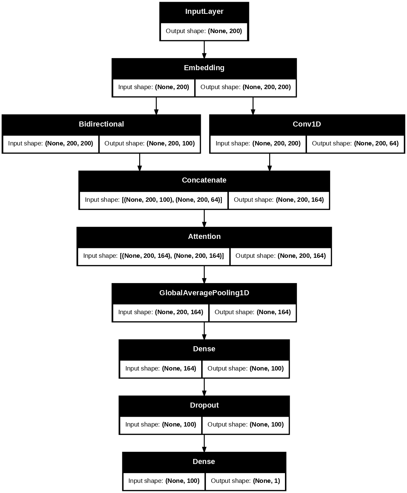
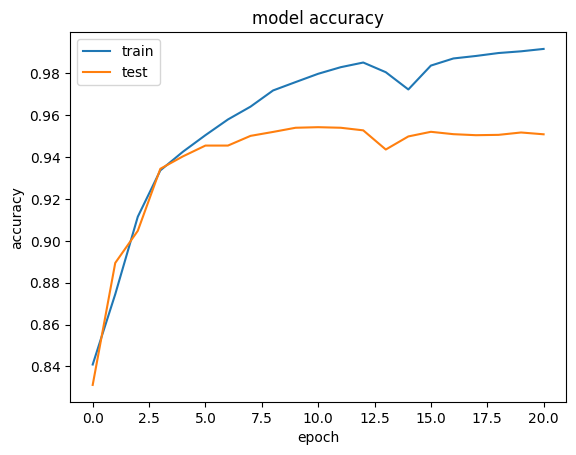
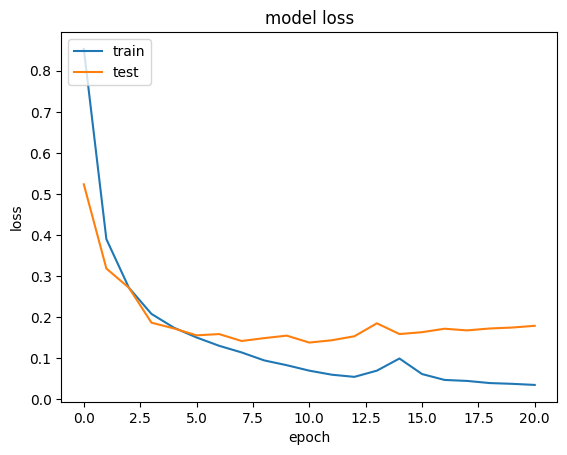
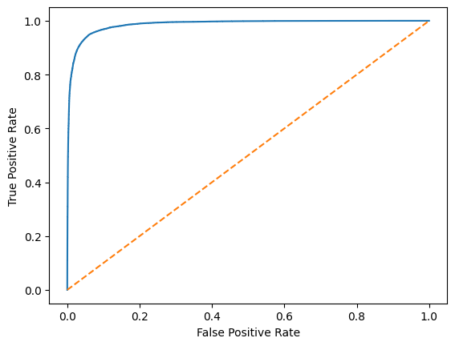

# ConvAttRecurNet — Attention-based Hybrid Model for Suicidal Thoughts Detection

Code for **"ConvAttRecurNet: An Attention-based Hybrid Model for Suicidal Thoughts Detection"**
Sai Pavan Veluguri — *2025 3rd International Conference on Disruptive Technologies (ICDT)*, IEEE.

[](https://doi.org/10.1109/ICDT63985.2025.10986603)
[](https://ieeexplore.ieee.org/document/10986603)
[](LICENSE)

> ⚠️ **Research use only.** This model is not a clinical or crisis-screening tool and must not be used to make decisions about any individual.
> If you or someone you know is struggling, in the US call or text **988** (Suicide & Crisis Lifeline), or find international lines at [findahelpline.com](https://findahelpline.com).

---

## Overview

Warning signs of suicidal ideation often show up in what people write online before a crisis. ConvAttRecurNet classifies social-media posts as **suicidal** or **non-suicidal** by combining three complementary components:

- **CNN (Conv1D)** — picks up local n-gram patterns and phrases
- **BiLSTM** — captures long-range context in both directions
- **Attention** — emphasizes the tokens and phrases that matter most for the decision

The model is compared against two baselines, **BiLSTM** and **BiLSTM + Attention**, and generalizes best of the three.

<p align="center"></p>

## Architecture

```
Input (200 tokens)
   └─► Embedding (200-d)
          ├─► BiLSTM (50 units × 2 directions) ──┐
          └─► Conv1D (64 filters, kernel 3) ─────┴─► Concatenate (164 features/token)
                                                        └─► Self-attention
                                                               └─► GlobalAveragePooling1D
                                                                      └─► Dense(100, ReLU, L2) ─► Dropout(0.5)
                                                                             └─► Dense(1, sigmoid)
```

~15.6M trainable parameters (most in the embedding layer). Trained with binary cross-entropy, Adam (lr = 1e-4), batch size 128, early stopping on validation loss.

## Dataset

[Suicide and Depression Detection](https://www.kaggle.com/datasets/nikhileswarkomati/suicide-watch) (Kaggle) — 232,074 Reddit posts collected with the Pushshift API, labelled *suicide* / *non-suicide* with the two classes evenly balanced.

The dataset is **not** included in this repo. Download `Suicide_Detection.csv` from Kaggle and update the `read_csv` path in the notebooks (they currently point to the Kaggle input folder).

**Preprocessing:** lowercasing, HTML stripping, accent removal, contraction expansion, removal of special characters, tokenization and stop-word removal (NLTK), then integer encoding and padding.

## Repository structure

```
convattrecurnet/
├── notebooks/
│   ├── 01_bilstm_baseline.ipynb
│   ├── 02_bilstm_attention_baseline.ipynb
│   └── 03_convattrecurnet.ipynb        # proposed model
├── assets/                             # architecture, training curves, ROC
├── requirements.txt
├── CITATION.cff
└── LICENSE
```

## Getting started

```bash
git clone https://github.com/velugurisaipavan/Convattrecurnet.git
cd Convattrecurnet
pip install -r requirements.txt
python -m nltk.downloader punkt punkt_tab stopwords
jupyter notebook notebooks/03_convattrecurnet.ipynb
```

The experiments were run on Kaggle with an NVIDIA P100 GPU; the notebooks run as-is in a Kaggle notebook with the dataset attached.

## Results

Performance reported in the paper (Table I):

| Model | Train Acc | Val Acc | **Test Acc** | Test Loss | Train time |
|---|---|---|---|---|---|
| BiLSTM | 97.17% | 94.60% | 93.90% | 0.1900 | 30 min |
| BiLSTM + Attention | 99.38% | 95.28% | 93.14% | 0.2333 | 8.4 min |
| **ConvAttRecurNet** | 98.53% | 94.37% | **94.06%** | 0.1908 | 20.3 min |

ConvAttRecurNet has the highest test accuracy, and its validation and test accuracy are the closest of the three models (94.37% vs 94.06%), so it generalizes most consistently to unseen data. BiLSTM + Attention fits the training data most closely but has the lowest test accuracy.

ConvAttRecurNet on the 46,415-post test set:

| Class | Precision | Recall | F1 |
|---|---|---|---|
| Non-suicidal | 0.926 | 0.958 | 0.942 |
| Suicidal | 0.957 | 0.923 | 0.939 |

ROC AUC = **0.986**

<p align="center">
  
  
  
</p>

## Citation

```bibtex
@inproceedings{veluguri2025convattrecurnet,
  author    = {Veluguri, Sai Pavan},
  title     = {ConvAttRecurNet: An Attention-based Hybrid Model for Suicidal Thoughts Detection},
  booktitle = {2025 3rd International Conference on Disruptive Technologies (ICDT)},
  year      = {2025},
  publisher = {IEEE},
  doi       = {10.1109/ICDT63985.2025.10986603}
}
```

## License

Code is released under the [MIT License](LICENSE). The paper is © IEEE; please read it on [IEEE Xplore](https://doi.org/10.1109/ICDT63985.2025.10986603).
